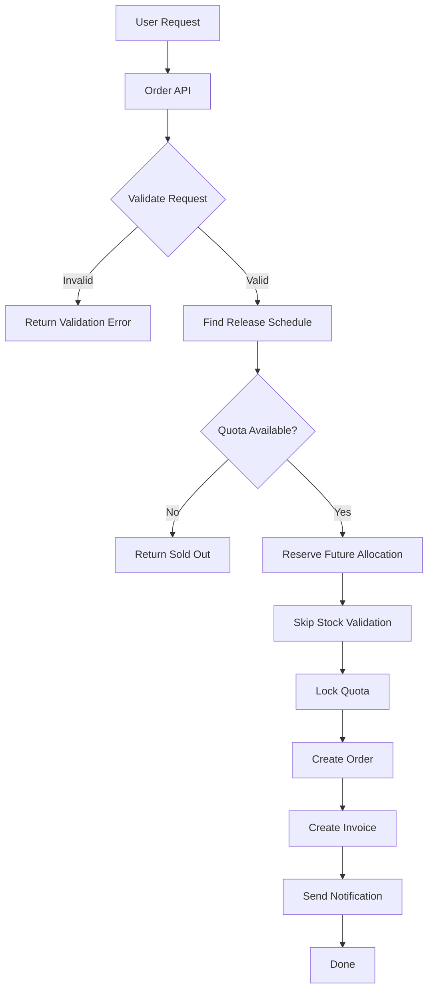
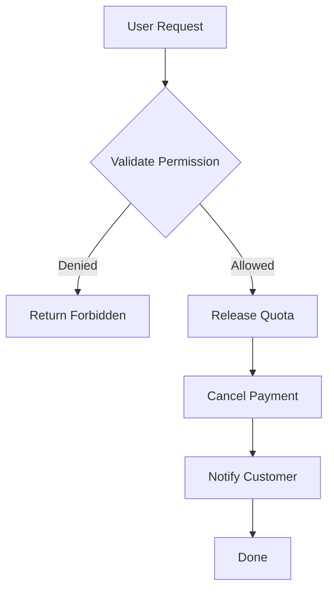
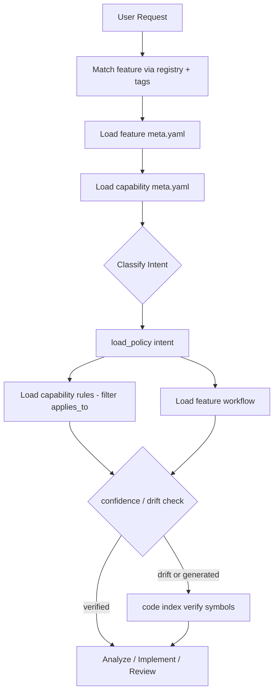

# Knowledge-Driven Development (KDD)

> Tài liệu chuẩn để thiết lập AI Knowledge Base cho bất kỳ dự án nào.
> Dùng file này làm input khi onboard dự án mới — Agent sẽ bootstrap KB theo spec dưới đây.

> **Ký hiệu trong file này:**
>
> - `<PREFIX>` — **không phải placeholder thay một lần**: mỗi capability có prefix mã business rule riêng, 2–3 chữ
>   hoa (vd. `OD` cho `order`, `PM` cho `payment`). File rule có dạng `<PREFIX>001.yaml`. Bảng "prefix theo module"
>   ở `.claude/PROJECT/kdd.md` (và `README.md` của từng capability) là nguồn tra; giữ nguyên ký hiệu `<PREFIX>` trong
>   file này khi điền template.
>
> Mọi ví dụ bên dưới dùng một domain giả định đơn giản — **bán hàng trực tuyến**: capability `order` (đơn hàng),
> prefix rule `OD`. Khi áp dụng cho dự án thật, thay bằng capability/feature/thuật ngữ của domain đó; phương pháp
> (tầng, định dạng, quy trình) giữ nguyên.

---

## Mục tiêu

Giúp AI Agent hiểu project **như một Tech Lead**: biết feature nào tồn tại, luồng xử lý ra sao, và **feature/capability
nào ảnh hưởng lẫn nhau** — tức nắm được "bản đồ" và tình trạng hệ thống trước khi động tay. KB không thay thế việc định
vị code; khi cần sửa code hoặc kiểm tra chi tiết implementation, Agent luôn quay lại code index — KB chỉ cho biết
**nên nhìn vào đâu và còn chỗ nào khác cần soi qua**.

- **Knowledge Base (KB)** — mô tả *nghiệp vụ*, *kiến trúc*, *luồng xử lý*, *quy tắc*, *quyết định thiết kế*, và
  *cross-capability impact* (`dependency-graph.yaml`) — trả lời "sửa cái này có thể ảnh hưởng cái gì khác"
- **Code index** — cách tìm code của repo (CLAUDE.md §Tìm code: công cụ index code nếu repo có, không thì Grep/Glob +
  Read); chỉ dùng để *định vị* và *explore* source code (symbol → file, call paths) — nguồn xác thực duy nhất khi cần sửa/verify code thật, kể cả khi KB đã trỏ đúng hướng

**Nguyên tắc phân tách:**

| Loại truth             | Nguồn          | Ví dụ                                              |
|------------------------|----------------|----------------------------------------------------|
| Semantic (WHY/WHAT)    | Knowledge Base | "Đơn B2B bỏ qua promotion engine"                  |
| Structural (WHERE/HOW) | code index      | `OrderService.create_order()` ở file nào, gọi ai   |

**Conflict resolution:**

- Nghiệp vụ (rules, workflow intent) → **KB wins**, báo drift code nếu lệch
- Cấu trúc (endpoint, schema, file) → **code index wins**, báo drift KB nếu lệch

---

## Kiến trúc phân tầng

```text
L0  Platform      .claude/PROJECT/ hoặc docs/knowledge/platform/
                Auth, stack, conventions, cross-cutting concerns

L1  Domain        docs/knowledge/medischedule/
                Glossary, bounded contexts

L2  Capability    docs/knowledge/medischedule/capabilities/
                Shared business knowledge (rules, state machine, ADR)

L3  Feature       docs/knowledge/medischedule/features/
                Feature variants kế thừa capability

L4  Ephemeral     docs/tasks/, docs/design/
                Per-change specs (BA, tech design) — distill vào L2/L3 sau merge

L5  Code anchor   code index + auto-generated refs (OpenAPI, capability index)
                Structural truth — không copy tay vào KB
```

---

## Cấu trúc thư mục

```text
docs/knowledge/medischedule/
├── README.md                         # Entry point
├── registry.yaml                     # Slim index — chỉ list tên
├── dependency-graph.yaml             # AUTO-GENERATED — depends_on + depended_by, không sửa tay
├── MAINTENANCE.md                    # Quarterly review, effectiveness tracking
│
├── glossary/
│   ├── index.yaml                    # Term registry + xref
│   ├── OrderLine.md
│   ├── Sku.md
│   └── Preorder.md
│
├── architecture/
│   ├── overview.md
│   ├── modules.md
│   └── dependencies.md
│
├── capabilities/
│   └── order/
│       ├── meta.yaml
│       ├── README.md
│       ├── state-machine.yaml
│       ├── business-rules/
│       │   ├── index.yaml
│       │   ├── OD001.yaml
│       │   ├── OD002.yaml
│       │   └── OD003.yaml
│       ├── traceability.yaml
│       └── adr/
│           ├── ADR-001.md
│           └── ADR-003.md
│
└── features/
    ├── standard-order/
    │   ├── meta.yaml
    │   ├── README.md
    │   └── workflow.md
    │
    ├── preorder/
    │   ├── meta.yaml
    │   ├── README.md
    │   ├── workflow.md
    │   └── adr/
    │       └── ADR-002.md
    │
    └── b2b-order/
        ├── meta.yaml
        ├── README.md
        ├── workflow.md
        └── state-machine-overrides.yaml   # optional — additional transitions
```

### Capability vs Feature

| Khái niệm      | Vai trò                                     | Ví dụ                                           |
|----------------|---------------------------------------------|-------------------------------------------------|
| **Capability** | Bounded context lớn, chứa shared knowledge  | `order`, `payment`, `inventory`                 |
| **Feature**    | Variant/use case cụ thể, kế thừa capability | `standard-order`, `preorder`, `b2b-order`       |

Một capability như **Order** thường chứa nhiều feature nhỏ dùng chung business rules và state machine.
Khi thêm feature mới (vd. "Subscription Order"), chỉ cần tạo folder feature mới tham chiếu capability hiện có —
không sao chép workflow/rule.

**Inheritance model:**

- Capability owns: `state-machine.yaml`, `business-rules/`, shared `adr/`, `traceability.yaml`
- Feature owns: `workflow.md` (variant-specific), optional `adr/`, optional `state-machine-overrides.yaml`
- Feature **kế thừa** rules từ capability, filter theo `applies_to`
- Feature **append** transitions (không mutate capability state machine)

---

## registry.yaml

Slim index — **không chứa metadata, documents, code paths**.
Toàn bộ metadata nằm trong `meta.yaml` của từng capability/feature.

```yaml
# docs/knowledge/medischedule/registry.yaml

capabilities:
  - order
  - payment
  - inventory

features:
  - standard-order
  - preorder
  - b2b-order
  - member-order
```

Scale tốt: registry luôn ngắn dù có hàng trăm feature.

---

## dependency-graph.yaml — Cross-Capability Impact

`depends_on` trong capability `meta.yaml` chỉ ghi chiều đi (outgoing) — hand-curated bởi tech-lead lúc distill.
Không đủ để trả lời "sửa capability X thì capability nào khác có nguy cơ bị ảnh hưởng" (chiều ngược), nên
`dependency-graph.yaml` tồn tại như một index **auto-generated**, tính từ toàn bộ `depends_on` trong domain:

```yaml
# docs/knowledge/medischedule/dependency-graph.yaml — AUTO-GENERATED, KHÔNG sửa tay

capabilities:
  order:
    depends_on: [ customer, catalog, inventory, notification ]
    depended_by: [ fulfillment, invoicing, notification ]     # ai depends_on: [order, ...]
```

**Generate:** `python scripts/gen_dependency_graph.py --domain medischedule` (đọc `depends_on` từ mọi capability
`meta.yaml`, tính `depended_by` ngược). **Validate freshness:** `scripts/validate_knowledge.py` tự gọi
`gen_dependency_graph.py --check` — fail nếu file committed lệch với `depends_on` hiện tại.

**Dùng khi nào (bắt buộc cho Flow C — Modify):**

1. BA match `capability` đang sửa → tra `depended_by` trong `dependency-graph.yaml`
2. Ghi danh sách capability bị ảnh hưởng vào BA spec (mục "Cross-Capability Impact")
3. QA dùng danh sách đó để scope Regression Check — không tự thu hẹp phạm vi theo cảm tính

**Khi nào regenerate:** Bất kỳ lúc `depends_on` của 1 capability đổi (thêm/bớt dependency) trong bước
`knowledge-distill` — tech-lead chạy lại script, không sửa tay `dependency-graph.yaml`.

---

## meta.yaml — Capability

```yaml
# capabilities/order/meta.yaml

id: order
type: capability
domain: medischedule
priority: core

description: Đơn hàng — mọi variant đều kế thừa

shared:
  state_machine: state-machine.yaml
  rules: business-rules/index.yaml
  traceability: traceability.yaml
  adr: [ ADR-001, ADR-003 ]

features:
  - standard-order
  - preorder
  - b2b-order
  - member-order

main_symbols:
  - OrderService
  - OrderRepository
  - OrderValidator
  - PromotionService

depends_on:                             # one-directional, hand-curated — reverse (depended_by) tính bởi script
  - payment
  - notification

tags:
  - order
  - checkout

# --- Knowledge lifecycle ---

knowledge_version: 1
last_review: "2026-07-01"
reviewed_by: tech-lead
generated_from: null                    # null = hand-curated; hoặc path BA spec nguồn
last_verified: "2026-07-10"

confidence:
  state_machine: verified               # verified | partial | generated | stale
  rules: verified
  symbols: generated
  traceability: partial

drift:
  state_machine: false
  rules: false
  symbols: true                         # true → Agent phải verify qua code index
  tests: false

auto_verify: [ symbols ]                  # phần nào Agent tự trigger code index verify

read_priority:
  README: 1
  state_machine: 2
  rules: 3
  traceability: 4
  adr: 5
```

---

## meta.yaml — Feature

```yaml
# features/preorder/meta.yaml

id: preorder
type: feature
capability: order                       # → Agent load capability meta trước

priority: core
description: Đặt trước sản phẩm chưa mở bán — giữ suất theo lịch phát hành

entry_symbols:
  - OrderService.create_order

additional_rules: [ OD004 ]              # rules chỉ áp dụng cho feature này

documents:
  workflow: workflow.md

adr: [ ADR-002 ]

tags:
  - preorder
  - checkout

related_features:
  - b2b-order
  - standard-order

# --- Knowledge lifecycle ---

knowledge_version: 1
last_review: "2026-07-01"
reviewed_by: tech-lead
generated_from: docs/tasks/preorder-ba-spec.md
last_verified: "2026-07-10"

confidence:
  workflow: verified
  rules: inherited                        # kế thừa từ capability
  symbols: generated

drift:
  workflow: false
  rules: false
  symbols: false

auto_verify: [ symbols ]

# --- Intent-based loading ---

load_policy:
  bugfix:
    - capability:business-rules
    - workflow.md
  new_feature:
    - README.md
    - capability:README
    - workflow.md
    - capability:state-machine
  code_review:
    - capability:business-rules
    - adr/
  explore:
    - README.md

read_priority:
  README: 1
  workflow: 2
  rules: 3
  traceability: 4
```

### Giá trị `confidence`

| Giá trị     | Ý nghĩa                    | Agent behavior                     |
|-------------|----------------------------|------------------------------------|
| `verified`  | TL/BA đã review, khớp code | Tin tưởng, dùng trực tiếp          |
| `partial`   | Một phần đã verify         | Dùng nhưng cảnh báo user           |
| `generated` | Auto-gen hoặc chưa review  | Verify qua code index trước khi tin |
| `stale`     | Quá hạn review             | Bắt buộc verify trước khi dùng     |
| `inherited` | Kế thừa từ capability      | Follow capability confidence       |

### Giá trị `drift`

Khi `drift.{field}: true` → Agent **bắt buộc** verify field đó qua code index trước khi hành động.
Kết quả verify → cập nhật KB hoặc báo user.

**Kỷ luật set `drift.symbols`:** Không chỉ set khi rename. Bất kỳ lúc nào tech-lead (review PR, quarterly
spot-check) phát hiện symbol thật trong code KHÔNG có trong `main_symbols`/`traceability.yaml`, hoặc ngược lại
symbol trong KB không còn tồn tại trong code → set `drift.symbols: true` ngay, dù không có refactor rename nào
xảy ra. `drift` chỉ có giá trị nếu được set trung thực mỗi khi phát hiện lệch — không phải chỉ 1 trường hợp
(rename) trong toàn bộ vòng đời KB.

---

## Business Rules

Mỗi rule là **một file YAML riêng** — git conflict gần như bằng 0.

**Mã rule:** `<PREFIX>` + số 3 chữ số, tăng dần trong capability (vd. `OD001`, `OD002`…). Mỗi capability
có prefix riêng, khai trong `README.md` của capability và bảng prefix ở `.claude/PROJECT/kdd.md`. Trước khi lấy mã mới, đọc lại `index.yaml` **và** kiểm tra
file đã tồn tại chưa — nhiều phiên làm song song có thể lấy cùng một mã cách nhau vài phút.

### index.yaml

```yaml
# capabilities/order/business-rules/index.yaml

rules:
  - id: OD001
    file: OD001.yaml
    applies_to: all
    priority: must

  - id: OD002
    file: OD002.yaml
    applies_to: all
    priority: must

  - id: OD003
    file: OD003.yaml
    applies_to: [ b2b-order ]
    priority: must

  - id: OD004
    file: OD004.yaml
    applies_to: [ preorder ]
    priority: must

  - id: OD005
    file: OD005.yaml
    applies_to: all
    priority: must
```

### OD003.yaml

```yaml
id: OD003
title: B2B order skips promotion engine
priority: must                              # must | should | may

condition: order.type == b2b
action: skip PromotionService

applies_to: [ b2b-order ]
exceptions: [ ]

owner: backend
since: "2025-03"

enforced_in:
  - symbol: OrderService.create_order
  - symbol: PromotionService.should_apply

related_adr: [ ADR-001 ]
related_tests:
  - symbol: TestB2bOrderSkipPromotion
```

### Rule filtering (Agent)

Khi làm task cho feature `preorder`:

1. Load `capabilities/order/business-rules/index.yaml`
2. Filter rules có `applies_to: all` HOẶC `applies_to` chứa `preorder`
3. Chỉ load file YAML của rules matched

---

## State Machine

Dùng **transitions YAML** — không dùng diagram tuyến tính (Draft → Pending → ...).

### capabilities/order/state-machine.yaml

```yaml
states:
  - draft
  - pending
  - confirmed
  - packed
  - shipped
  - completed
  - cancelled

initial: draft
terminal: [ completed, cancelled ]

transitions:
  - from: draft
    to: pending
    guard: request_valid

  - from: pending
    to: confirmed
    guard: payment_success
    side_effects: [ notify_customer ]

  - from: pending
    to: cancelled
    guard: user_or_admin
    side_effects: [ release_stock, cancel_payment, notify_customer ]

  - from: confirmed
    to: packed
    guard: stock_reserved

  - from: packed
    to: shipped
    guard: carrier_picked_up

  - from: shipped
    to: completed
    guard: customer_received
```

### Feature override — additional transitions (preferred)

Feature **không mutate** capability state machine. Chỉ **append** transitions riêng:

```yaml
# features/b2b-order/state-machine-overrides.yaml

additional_transitions:
  - from: draft
    to: confirmed
    guard: order.type == b2b AND admin_approved
    side_effects: [ notify_account_manager ]
    note: Đơn B2B bỏ qua pending khi admin duyệt trực tiếp (thanh toán công nợ)
```

Agent merge: capability transitions + feature additional_transitions.

---

## Workflow

Dùng **Mermaid flowchart** — diễn tả được branch, condition, parallel paths.

### features/preorder/workflow.md

````markdown
# Preorder Workflow

## Create Preorder



## Cancel Preorder


````

---

## Traceability

Mapping giữa nghiệp vụ và code — **dùng symbol, không dùng file path**.

```yaml
# capabilities/order/traceability.yaml

workflows:
  create_order:
    steps: [ validate, check_stock, apply_promotion, reserve, save, invoice, notify ]
    entry_symbol: OrderService.create_order

  cancel_order:
    steps: [ validate, release_stock, cancel_payment, notify ]
    entry_symbol: OrderService.cancel_order

rules:
  OD003:
    enforced_in:
      - symbol: OrderService.create_order
      - symbol: PromotionService.should_apply
    related_tests:
      - symbol: TestB2bOrderSkipPromotion

  OD004:
    enforced_in:
      - symbol: OrderValidator.validate_stock
    related_tests:
      - symbol: TestPreorderSkipStockCheck
```

**Quy tắc:**

- `symbol` → code index resolve → file + line
- `related_tests` → dùng **test class/method name**, không dùng file path
- Không lưu `app/services/order_service.py` — lưu `OrderService`

---

## ADR (Architecture Decision Records)

Mỗi ADR là **một file markdown riêng**.

```text
capabilities/order/adr/
    ADR-001.md
    ADR-003.md

features/preorder/adr/
    ADR-002.md
```

### ADR-001.md

```markdown
# ADR-001: Promotion Before Save

## Status

Accepted

## Context

Tạo đơn cần tính khuyến mãi trước khi persist.

## Decision

Promotion engine chạy trước khi save order vào DB.

## Reason

Tránh unnecessary DB writes khi tính khuyến mãi fail.

## Consequences

- Tăng latency create order (~200ms)
- Giảm orphan records trong DB

## Related

- Rule: OD003
- Symbol: OrderService.create_order
```

Feature `meta.yaml` reference ADR qua list:

```yaml
adr: [ ADR-002 ]
```

Capability `meta.yaml` reference shared ADR:

```yaml
shared:
  adr: [ ADR-001, ADR-003 ]
```

---

## Glossary

Mỗi thuật ngữ là **một file markdown riêng** — dễ xref, dễ mở rộng.

### glossary/index.yaml

```yaml
terms:
  - id: order-line
    file: OrderLine.md
    aliases: [ line item, dòng hàng ]

  - id: sku
    file: Sku.md
    aliases: [ mã hàng, stock keeping unit ]

  - id: allocation
    file: Allocation.md

  - id: preorder
    file: Preorder.md
    related_features: [ preorder ]
    related_rules: [ OD004 ]

  - id: b2b
    file: B2b.md
    related_features: [ b2b-order ]
```

### glossary/OrderLine.md

```markdown
# Order Line

Một dòng trong đơn hàng: một SKU kèm số lượng và đơn giá tại thời điểm đặt.

## Related Terms

- [SKU](Sku.md)
- [Preorder](Preorder.md)

## Used In

- Capability: order
- Rules: OD001 (tối đa 50 dòng mỗi đơn)
```

---

## README.md — Capability

```markdown
# Order

## Purpose

Cho phép khách đặt mua hàng — mọi variant (standard, preorder, b2b, member).

## Rule prefix

`OD`

## Responsibilities

- Create / Update / Cancel Order
- Confirm / Complete Order
- Stock reservation
- Promotion application

## Feature Variants

| Feature | Description |
|---------|-------------|
| standard-order | Đơn mua thường, thanh toán ngay |
| preorder | Đặt trước sản phẩm chưa mở bán |
| b2b-order | Đơn doanh nghiệp, thanh toán công nợ |
| member-order | Đơn cho hội viên, áp giá hội viên |

## Main Symbols

OrderService, OrderRepository, OrderValidator, PromotionService

## Dependencies

payment, notification
```

---

## README.md — Feature

```markdown
# Preorder

## Purpose

Đặt trước sản phẩm chưa mở bán — giữ suất theo lịch phát hành, chưa trừ tồn kho thật.

## Capability

Inherits from: [order](../capabilities/order/README.md)

## Specific Rules

- OD004: Preorder bỏ qua kiểm tra tồn kho

## Entry Symbol

OrderService.create_order
```

---

## docs/knowledge/medischedule/README.md — Entry Point

```markdown
# Knowledge Base

Knowledge-Driven Development (KDD) — AI hiểu nghiệp vụ qua KB, định vị code qua code index.

## Quick Start (Agent)

1. Read `registry.yaml` — discover capabilities + features
2. Match user request → feature (or capability if ambiguous)
3. Load feature `meta.yaml` → follow `capability` link
4. Classify intent → `load_policy[intent]`
5. Load docs theo priority + filter rules by `applies_to`
6. If `drift.*: true` or `confidence.*: generated|stale` → verify via code index
7. Code index resolve symbols → implement / review

## Structure

| Path | Purpose |
|------|---------|
| registry.yaml | Slim index |
| glossary/ | Domain terminology |
| architecture/ | System architecture |
| capabilities/ | Shared business knowledge |
| features/ | Feature variants |

## Conflict Resolution

- Business rules / workflow → KB wins
- Code structure / API paths → code index wins
```

---

## Quy trình Agent

```text
User Request
     │
     ▼
Match feature/capability (registry.yaml + tags)
     │
     ▼
Load feature meta.yaml
     │ capability: order
     ▼
Load capability meta.yaml
     │
     ▼
Classify Intent (bugfix | new_feature | code_review | explore)
     │
     ▼
load_policy[intent] → load minimal docs
     │
     ├── Capability docs (rules filtered by applies_to, state machine)
     ├── Feature docs (workflow, feature ADR)
     │
     ▼
Check confidence + drift
     │ drift.symbols=true OR confidence.symbols=generated
     ▼
Code index verify symbols
     │
     ▼
Analyze / Implement / Review
```



---

## Vai trò từng thành phần

| Thành phần                     | Scope                | Mục đích                                           |
|--------------------------------|----------------------|----------------------------------------------------|
| `registry.yaml`                | Root                 | Slim index — list tên capability + feature         |
| `meta.yaml`                    | Capability / Feature | Routing, lifecycle, confidence, drift, load_policy |
| `README.md`                    | Capability / Feature | Tổng quan purpose, responsibilities                |
| `workflow.md`                  | Feature              | Luồng nghiệp vụ variant-specific (Mermaid)         |
| `business-rules/`              | Capability           | Rules dùng chung, filter theo `applies_to`         |
| `state-machine.yaml`           | Capability           | States + transitions + guards + side_effects       |
| `state-machine-overrides.yaml` | Feature (optional)   | Additional transitions — append only               |
| `traceability.yaml`            | Capability           | Rule/workflow → symbol mapping                     |
| `adr/`                         | Capability / Feature | Architecture Decision Records                      |
| `glossary/`                    | Domain               | Thuật ngữ nghiệp vụ                                |
| `architecture/`                | Domain               | Kiến trúc hệ thống                                 |
| Code index                      | Code                 | Symbol → file, call paths, dynamic dispatch        |

### Những gì KHÔNG nên có trong KB

| Không tạo                        | Thay bằng                                                  |
|----------------------------------|------------------------------------------------------------|
| `implementation.md` (file paths) | `traceability.yaml` + code index                            |
| `api.md` (full endpoint list)    | Auto-generated ref + `api-semantics.md` (chỉ side effects) |
| `database.md` (full schema)      | code index model symbol + business meaning ngắn             |
| File paths trong meta/registry   | Symbol names → code index resolve                           |
| Test file paths                  | Test class/method symbol → code index resolve               |

---

## Knowledge Lifecycle

```text
BA spec (ephemeral) → Tech Design (ephemeral) → Implement → Merge
                                                  │
                                    Distill (30 min TL review)
                                                  │
                                    Update capability/feature KB
                                                  │
                                    Bump knowledge_version
                                    Update confidence + drift
```

### Khi nào update KB

| Trigger                       | Action                                              |
|-------------------------------|-----------------------------------------------------|
| Feature core merged + QA PASS | TL distill vào L2/L3                                |
| Business rule thay đổi        | Update/create rule YAML, bump version               |
| Refactor rename symbol        | Update traceability symbols, set drift.symbols=true |
| ADR mới                       | Tạo file ADR, reference trong meta.yaml             |
| Quarterly review              | TL review confidence, reset drift flags             |

### Distill checklist (sau merge feature)

- [ ] Rules mới → `business-rules/<PREFIX>*.yaml` + update `index.yaml`
- [ ] Workflow variant → `features/{name}/workflow.md`
- [ ] ADR quan trọng → `adr/ADR-*.md`
- [ ] Symbols → update `traceability.yaml` + `main_symbols` trong meta
- [ ] Bump `knowledge_version`, set `confidence`, reset `drift`
- [ ] Update `last_review`, `reviewed_by`, `generated_from`

---

## Validation (CI — recommended)

Script `scripts/validate_knowledge.py` (tùy project implement):

1. Mọi entry trong `registry.yaml` → folder + `meta.yaml` tồn tại
2. Mọi `main_symbols` / `entry_symbols` → code index symbol tồn tại
3. Mọi rule trong `index.yaml` → file YAML tồn tại
4. Mọi `applies_to` feature → có trong registry
5. Mọi `related_tests` symbol → code index resolve được
6. Mọi ADR referenced trong meta → file tồn tại
7. Cảnh báo nếu `knowledge_version` stale (> 90 ngày since `last_review`)
8. `dependency-graph.yaml` khớp với `depends_on` hiện tại trong mọi capability `meta.yaml` (gọi
   `scripts/gen_dependency_graph.py --check`) — fail nếu lệch

Check #2 (`main_symbols`/`entry_symbols` tồn tại thật trong code, không chỉ tồn tại trong KB) đòi hỏi code index
chạy được trong CI — nếu môi trường CI chưa có code index, đây là check thủ công (quarterly spot-check trong
`MAINTENANCE.md`), không phải CI gate. Đừng giả định check này chạy tự động nếu chưa verify CI thực sự gọi được
code index.

## Skill / Agent Instructions — quy tắc bắt buộc

Mọi skill/agent instruction có code impact (BA, SA, TL, engineer, reviewer, QA) khi được tạo mới phải có 1 trong 2:

1. Section "Load KB" tham chiếu rõ quy trình 4 bước ở [Quy trình Agent](#quy-trình-agent) (registry match →
   `load_policy[intent]` → filter `applies_to` → check `confidence`/`drift`), hoặc
2. Restate ngắn gọn cả 4 bước inline.

Đây không phải optional — một skill có code impact mà thiếu bước Load KB sẽ khiến toàn bộ đầu tư vào KB vô nghĩa
cho riêng skill đó (nó sẽ luôn tự suy luận lại từ đầu qua code index/grep thay vì tận dụng KB đã có). Review thủ
công khi thêm skill mới — không có cách tự động hóa check này vì skill file (markdown) không execute được.

---

## Bootstrap dự án mới

Khi onboard project mới, Agent thực hiện theo thứ tự:

### Phase 1 — Scaffold

```text
1. Tạo docs/knowledge/medischedule/ (slug domain đã chốt khi điền template) theo cấu trúc thư mục ở trên
2. Tạo registry.yaml (rỗng hoặc list capabilities dự kiến)
3. Tạo glossary/index.yaml + thu thập thuật ngữ domain
4. Tạo architecture/ từ codebase overview
5. Tạo docs/knowledge/medischedule/README.md entry point
```

### Phase 2 — Pilot 1 capability

Chọn 1 capability core (vd. `order`), chốt `<PREFIX>` cho nó:

```text
1. Tạo capabilities/{name}/meta.yaml
2. Reverse-engineer 5–10 business rules thật từ code → business-rules/<PREFIX>*.yaml
3. Reverse-engineer state machine từ enum/status fields → state-machine.yaml
4. Tạo traceability.yaml với symbols thật (code index verify)
5. Tạo 1–2 feature variants có workflow.md
6. Viết 2–3 ADR cho decisions quan trọng đã biết
```

### Phase 3 — Validate

```text
1. Cho Agent 5 task thật (bugfix, modify, review, explore)
2. Đo: số file đọc, accuracy, có cần code index fallback không
3. Tune load_policy, read_priority
4. Fix drift/confidence flags
```

**Không phải bước một lần rồi bỏ.** Đây là vòng lặp liên tục — mỗi domain phải có tracking thật trong
`docs/knowledge/medischedule/MAINTENANCE.md` (mục "Effectiveness tracking"), review mỗi kỳ quarterly cùng lúc với
review `drift`/`confidence`. Nếu >50% sample task cho 1 capability phải fallback code index vì
`confidence: generated|stale`, hạ field đó xuống đúng thực trạng — **không giữ `verified` giả** chỉ vì đã review
1 lần lúc bootstrap. `confidence: verified` là lời hứa "agent có thể tin mà không cần verify lại" — sai lời hứa
này làm hỏng toàn bộ lợi ích tiết kiệm token của KDD.

### Phase 4 — Expand

```text
1. Thêm capabilities theo priority
2. Distill từ ephemeral docs (BA spec, tech design) sau mỗi merge
3. Bật CI validation
```

---

## Template nhanh — tạo feature mới

```text
# 1. Thêm vào registry.yaml
features:
  - subscription-order

# 2. Tạo folder
features/subscription-order/
  meta.yaml          # capability: order, tags, load_policy
  README.md          # purpose, inherits from order
  workflow.md        # Mermaid flowchart

# 3. Nếu có rules riêng → thêm vào capability
capabilities/order/business-rules/
  OD006.yaml         # applies_to: [subscription-order]
  index.yaml         # thêm entry OD006

# 4. Nếu có ADR riêng
features/subscription-order/adr/
  ADR-004.md
```

---

## Tham chiếu nhanh — Schema fields

### meta.yaml (capability)

```yaml
id, type, domain, priority, description
shared: { state_machine, rules, traceability, adr }
features: [ ]
main_symbols: [ ]
depends_on: [ ]
tags: [ ]
knowledge_version, last_review, reviewed_by, generated_from, last_verified
confidence: { state_machine, rules, symbols, traceability }
drift: { state_machine, rules, symbols, tests }
auto_verify: [ ]
read_priority: { }
```

### meta.yaml (feature)

```yaml
id, type, capability, priority, description
entry_symbols: [ ]
additional_rules: [ ]
documents: { workflow }
adr: [ ]
tags: [ ]
related_features: [ ]
knowledge_version, last_review, reviewed_by, generated_from, last_verified
confidence: { workflow, rules, symbols }
drift: { workflow, rules, symbols }
auto_verify: [ ]
load_policy: { bugfix, new_feature, code_review, explore }
read_priority: { }
```

### business rule (<PREFIX>*.yaml)

```yaml
id, title, priority, condition, action
applies_to: [ all | feature-names ]
exceptions: [ ]
owner, since
enforced_in: [ { symbol } ]
related_adr: [ ]
related_tests: [ { symbol } ]
```

### state machine

```yaml
states: [ ]
initial, terminal: [ ]
transitions: [ { from, to, guard, side_effects } ]
```

### traceability

```yaml
workflows: { name: { steps, entry_symbol } }
rules: { id: { enforced_in, related_tests } }
```
